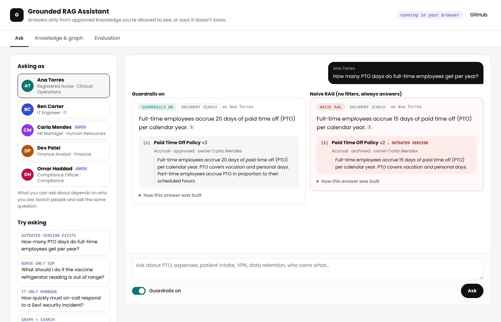
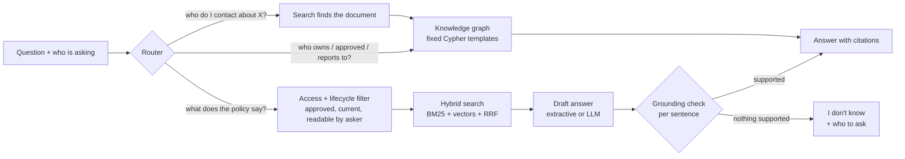
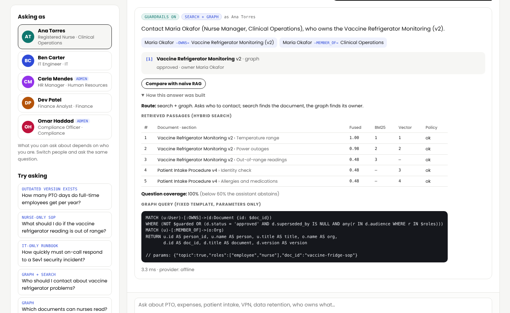
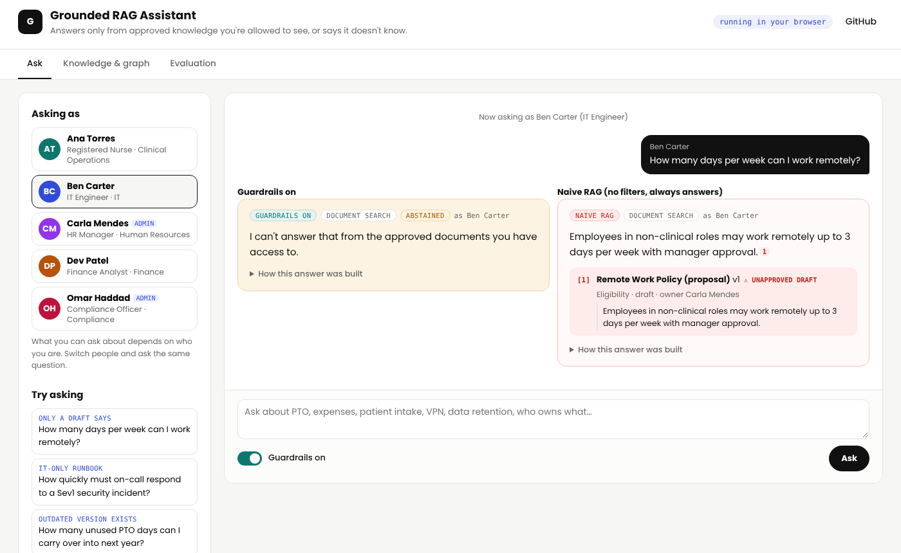
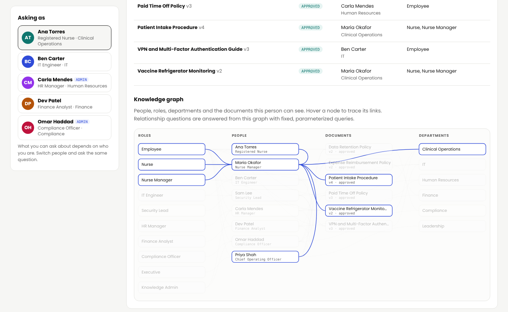

# Grounded RAG Assistant

**Answers only from approved knowledge you're allowed to see. Cites every sentence. Says "I don't know" instead of guessing.**

Most enterprise RAG demos search everything and let the model write whatever sounds right. In a real company that goes wrong in four predictable ways: the assistant quotes an **outdated version** of a policy, quotes a **draft** nobody approved, **leaks** a document the person asking isn't allowed to read, or **makes up** an answer when the documents don't have one. This project is a RAG assistant built to stop all four, plus a **knowledge graph** for questions that are about relationships rather than text ("who owns this policy?", "which documents can nurses read?", "who do I report to?").

**[▶ Try the live demo](https://dharani-ch3.github.io/grounded-rag-assistant/)**: the real Python assistant running in your browser on WebAssembly ([Pyodide](https://pyodide.org)). No server, no sign-up. Pick who you are (a nurse, an IT engineer, an HR manager, a finance analyst or a compliance officer), ask a question, then click **Compare with naive RAG** to see what the same question gets with the guardrails off.

[](https://github.com/Dharani-ch3/grounded-rag-assistant/actions/workflows/ci.yml)
[](https://dharani-ch3.github.io/grounded-rag-assistant/)
[](https://render.com/deploy?repo=https://github.com/Dharani-ch3/grounded-rag-assistant)



## Results

Each evaluation question is asked twice, by a specific employee: once by **naive RAG** (search everything, always answer) and once **with guardrails**. Errors are classified automatically from the citations and the access policy, so nobody labels them by hand.

| | Tuning set (37 questions) | Held-out set (20 questions) |
|---|---|---|
| Naive RAG accuracy | 49% | 60% |
| **Guardrails accuracy** | **100%** | **80%** |
| Grounding errors, naive → guardrails | 19 → **0** | 8 → **0** |
| Needless "I don't know" with guardrails | 0 | 4 |

*Grounding errors* are answers that leaked restricted content, used a draft, used an outdated version, or answered a question the knowledge base can't answer.

Be careful with these numbers, and here's why. The tuning set was written alongside the engine, so 100% there is optimistic. The **held-out set** was written afterwards and never used to tune thresholds. It exposed one routing bug ("who approved X?" was answered with X's *owner*), which was fixed because it was a logic error. The abstention threshold was not changed to improve the score. On held-out questions the guardrails still made **zero** grounding errors, and the cost shows up as 4 cautious "I don't know" answers where the offline answerer's word matching was too strict (for example "Is alcohol reimbursable?"). That trade-off is deliberate: for policy questions, "I don't know, ask the owner" is a much cheaper failure than a confident wrong answer. Both sets are small and hand-written, so treat them as a regression test, not a benchmark. Full per-question results: [tuning](docs/eval-tuning.md), [held-out](docs/eval-holdout.md).

**CI enforces this**: every push runs both sets, and the build fails if guardrails mode makes a single grounding error.

## How it works



| Guardrail | What it does | Where |
|---|---|---|
| **Approved-only, current-only** | Drafts and superseded versions are filtered out *before* ranking, so they never compete for a slot in the context. Approving a new version archives the old one automatically. | [`knowledge.py`](assistant/knowledge.py), [`retrieval.py`](assistant/retrieval.py) |
| **Permission-aware retrieval** | Every document has an audience (roles). The asker's roles are applied as a filter in both BM25 and vector search, and pushed down into Pinecone / Weaviate as a metadata filter. Restricted passages aren't even *counted* in the trace, so their existence isn't revealed. | [`retrieval.py`](assistant/retrieval.py), [`backends/`](assistant/backends) |
| **Sentence-level grounding check** | Every sentence must cite a source, and it's dropped if its words aren't mostly in that source or if it has a **number, amount or percentage that isn't in the source**. Wrong numbers are the most common and most harmful hallucination in policy answers. | [`grounding.py`](assistant/grounding.py) |
| **Abstention** | If the best passage doesn't cover the question, or no sentence survives the check, the assistant says it can't answer. When an allowed document is clearly on the same topic, it names the document's owner. | [`core.py`](assistant/core.py) |
| **Knowledge graph for relationships** | Users, roles, departments and documents with `OWNS`, `APPROVED`, `CAN_READ`, `MEMBER_OF`, `REPORTS_TO`, `SUPERSEDES` edges. The model never writes Cypher: questions map to fixed, parameterized templates, so there's nothing to inject. The same access predicate is inside every template. | [`graph.py`](assistant/graph.py), [`router.py`](assistant/router.py) |
| **Governance** | New documents start as drafts. Only knowledge admins can approve, and never their own documents. Every question, edit and approval goes to an audit log. | [`core.py`](assistant/core.py) |

Click any answer's **How this answer was built** to see the route, the retrieved passages with their BM25 and vector ranks, what was filtered out, the per-sentence grounding verdicts and, for graph answers, the exact Cypher template and parameters:



| Unapproved draft: refused vs quoted | Knowledge graph (hover to trace links) |
|---|---|
|  |  |

## The sample knowledge base

A fictional health network, **Ridgeway Health**, in [`knowledge/`](knowledge): 11 policies and procedures (PTO, expenses, patient intake, vaccine storage, incident response, VPN and MFA, data retention, executive compensation) and 8 people across 6 departments, with deliberate traps. There are archived versions with different numbers (15 vs 20 PTO days, $50 vs $75 meals), an unapproved remote-work draft, and restricted documents (the security runbook is IT-only, compensation is HR and executives only). Everything is fictional.

Documents are Markdown with front matter, so you can point the assistant at your own:

```markdown
---
id: pto-policy-v3
title: Paid Time Off Policy
version: 3
status: approved          # draft | approved | archived
owner: carla
approved_by: priya
org: hr
audience: employee        # roles that may read it
supersedes: pto-policy-v2
---
## Accrual
Full-time employees accrue 20 days of paid time off (PTO) per calendar year...
```

## Swappable backends

Every external piece sits behind a small interface, and the in-memory defaults need nothing installed.

| Piece | Default | Also supported | Set with |
|---|---|---|---|
| Answer model | `offline`: quotes the best sentences, no model | **Amazon Bedrock** (Converse API), Anthropic Claude, OpenAI, Ollama (local) | `ASSISTANT_PROVIDER` |
| Embeddings | Local feature hashing | Bedrock Titan, OpenAI, Ollama | `ASSISTANT_EMBEDDER` |
| Vector store | In-memory | **Pinecone**, **Weaviate** (access filter pushed into the query) | `ASSISTANT_VECTOR_STORE` |
| Graph store | In-memory | **Neo4j** (same templates as real Cypher) | `ASSISTANT_GRAPH_STORE` |

The Neo4j and Weaviate adapters are tested for real: a CI job starts both as containers and runs the full evaluation against them. Pinecone is a hosted service, so its adapter is tested against a mocked HTTP API. LLM answers go through the same grounding check as offline ones; the tests use a fake model that invents a number and an unsupported claim, and check that both are dropped.

## Quick start

```bash
git clone https://github.com/Dharani-ch3/grounded-rag-assistant
cd grounded-rag-assistant
pip install -r requirements.txt
uvicorn assistant.api:app --reload        # http://localhost:8000, API docs at /docs
```

Command line:

```bash
python -m assistant.cli ask "How many PTO days do I get per year?" --user ana
python -m assistant.cli ask "How many PTO days do I get per year?" --user ana --mode naive
python -m assistant.cli eval              # tuning set
python -m assistant.cli eval --holdout    # held-out set
```

With Neo4j and Weaviate (Docker):

```bash
docker compose up --build                 # assistant + Neo4j + Weaviate
```

With a real model, for example Bedrock:

```bash
pip install -r requirements-backends.txt
ASSISTANT_PROVIDER=bedrock AWS_REGION=us-east-1 uvicorn assistant.api:app
```

See [`.env.example`](.env.example) for every setting.

### Who is asking

What the assistant may answer depends on who asks, so every request names a user.

- **Demo mode** (default): the caller says who they are, which lets the web console switch between employees. Never expose this mode on a real network.
- **Keyed mode**: set `ASSISTANT_API_KEYS="KEY1:ana,KEY2:omar"` and send `X-API-Key`. The user comes from the key and anything the caller claims is ignored. In production, put SSO in front and map the identity provider's user to a directory user the same way.

### Use it from Claude or Cursor (MCP)

```json
{"mcpServers": {"grounded-rag": {
  "command": "python", "args": ["-m", "assistant.mcp_server"],
  "cwd": "/path/to/grounded-rag-assistant",
  "env": {"ASSISTANT_MCP_USER": "ana"}}}}
```

The agent gets `ask_knowledge_base`, `list_documents` and `read_document` with exactly the access that user has. The server tells the agent not to fill gaps from its own knowledge when the answer is "I don't know".

## How the live demo works

GitHub Pages only serves static files, so the demo brings Python to the browser instead of a server. The assistant's core uses only the Python standard library, so [`scripts/build_site.py`](scripts/build_site.py) bundles its modules and the knowledge base, and the page runs them on [Pyodide](https://pyodide.org) with no extra packages. The web console normally calls the REST API; in the demo it calls [`bridge.py`](assistant/bridge.py), which exposes the same routes as a function. The retrieval, graph, grounding and evaluation code that runs is the same code the server runs. The [`pages.yml`](.github/workflows/pages.yml) workflow runs the tests, rebuilds the demo and republishes it on every push to `main`.

## Project layout

```
assistant/
  core.py          ask(): route → filter → retrieve → answer → verify, plus approvals and audit
  knowledge.py     documents, people directory, the access policy (one function)
  retrieval.py     BM25 + vectors + reciprocal rank fusion, access filter as data
  grounding.py     extractive answerer and the per-sentence grounding check
  graph.py         knowledge graph, Cypher templates, in-memory implementation
  router.py        graph vs documents vs both; optional LLM routing from a fixed menu
  evaluation.py    naive vs guardrails scoring with automatic error classes
  gateway.py       Bedrock, Claude, OpenAI, Ollama behind one interface
  backends/        Pinecone, Weaviate, Neo4j adapters
  api.py  bridge.py  mcp_server.py  cli.py  static/
knowledge/         sample documents, directory, evaluation sets
tests/             unit tests, API tests, live backend tests (CI)
```

## Limits

- The offline answerer quotes sentences; it doesn't paraphrase or combine facts across documents. Use an LLM provider for fluent answers; they still pass through the same grounding check.
- The grounding check is lexical (word overlap and exact numbers). It catches invented numbers and off-topic claims well, but a sentence that reuses the source's words with a reversed meaning ("are reimbursable" vs "are not") can slip through. An NLI or LLM-judge check is the next step.
- Router rules cover common phrasings of relationship questions. With `ASSISTANT_LLM_ROUTER=true` a model picks the intent instead, but only from the fixed menu, and invalid choices fall back to the rules.

## License

MIT
